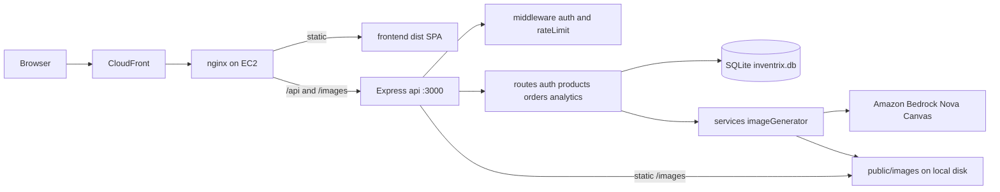
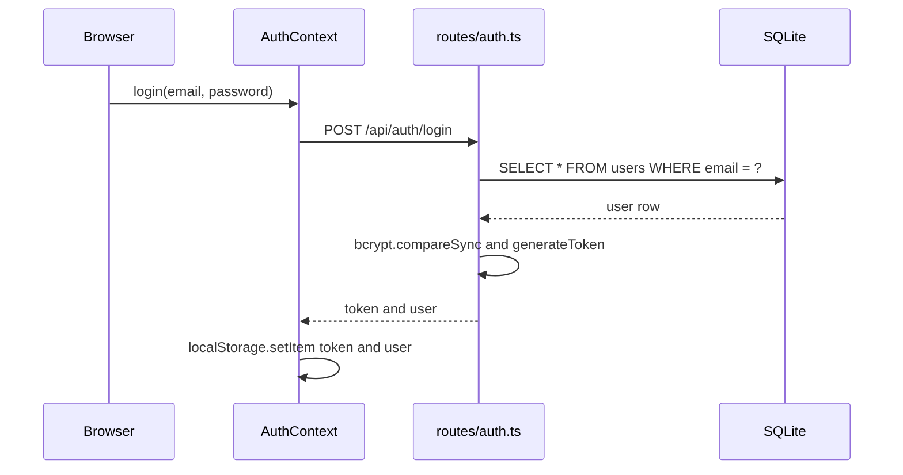
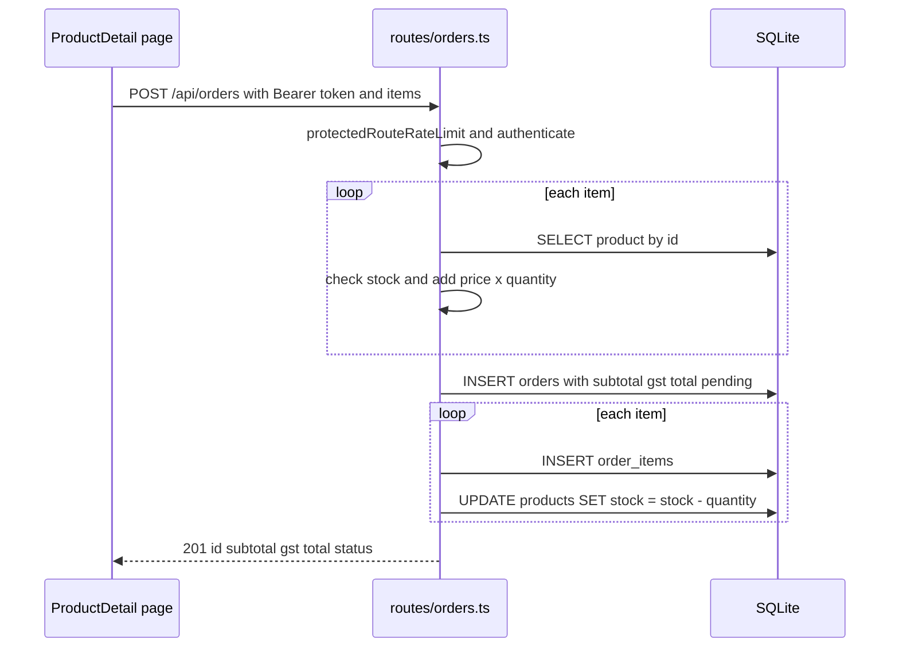
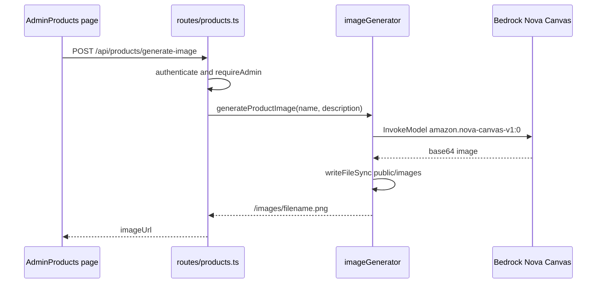

# Architecture

## Architecture Analysis

### System Overview

Inventrix 是一個 pnpm monorepo（`inventrix-code/`），包含兩個可部署單元：

- **frontend**：Vite + React 18 SPA，透過相對路徑 `/api`、`/images` 呼叫後端。
- **api**：單一 Express 4 process，內嵌 SQLite（better-sqlite3，檔案 `inventrix.db`），並呼叫 Amazon Bedrock 生成圖片。

目前的正式部署由 `inventrix-code/deploy.sh` 建立：CloudFront →（HTTP 80）→ 單台 EC2（Amazon Linux 2023）上的 nginx，nginx 提供 `frontend/dist` 靜態檔並反向代理 `/api`、`/images` 到 PM2 管理的 Node process（port 3000）。

### Architectural Style

**分層式單體（Layered Monolith）**，證據：

- 一個 Express app（`packages/api/src/index.ts`）掛載 4 個 router。
- 分層薄弱：route handler 直接呼叫 `db.prepare(...)`，沒有 service / repository 層；唯一的 service 是 `services/imageGenerator.ts`。
- 資料庫是 process 內嵌的檔案型 SQLite，無法水平擴展（多個 instance 會各自持有一份 DB）。

### Component Relationships

文字版：瀏覽器 → CloudFront → EC2 上的 nginx；nginx 直接提供 SPA 靜態檔，`/api` 與 `/images` 代理到 Express（port 3000）。Express 經 auth / rateLimit middleware 進入 4 個 router；router 直接讀寫 SQLite；products router 透過 imageGenerator 呼叫 Bedrock，並把圖片寫到本機 `public/images`，再由 Express 以靜態檔提供。

### Data Flow

- **讀取**：SPA 在 `useEffect` 中 `fetch` → nginx/Vite proxy → router → 同步 SQL → JSON 回傳。
- **寫入**：帶 `Authorization: Bearer <JWT>` 的請求 → `protectedRouteRateLimit` → `authenticate`（驗證 JWT）→ 必要時 `requireAdmin` → SQL 寫入。
- **身分**：登入後 JWT（7 天有效）與 user 物件存在瀏覽器 `localStorage`，由 `AuthContext` 提供給各頁面。
- **資料模型**：`users`、`products`、`orders`、`order_items` 四張表（`db.ts:7-47`），啟動時建立並在空 DB 時植入種子資料。

### Key Design Decisions

| 決策 | 影響 |
|---|---|
| 內嵌 SQLite + 同步 driver | 部署簡單；但無法多 instance、容器重啟會遺失資料（除非掛 volume），遷移到 PostgreSQL 需把 handler 改為 async |
| 無 repository 層 | SQL 散在各 route，資料庫替換的變更面等於全部 route |
| JWT 無狀態驗證 + `localStorage` | 無 session store；token 無法撤銷 |
| 圖片存本機檔案系統 | 單機可行；容器化或多 instance 需改用 S3 |
| 計價在伺服器端（`orders.ts:52-65`） | 正確地不信任前端價格；點數機制應沿用此原則 |
| 部署為命令式 shell 腳本 | 無 IaC、無 CI，環境不可重現 |

### Improvement Opportunities

- 抽出資料存取層（repository），為 PostgreSQL 遷移與測試鋪路。
- 下單流程加入 transaction 與輸入驗證。
- 加入 health check endpoint（容器與負載平衡器需要）及集中 error handler。
- 圖片儲存改 S3；設定改由環境變數 / Secrets Manager 注入。
- 以 IaC（例如 CDK）取代 `deploy.sh`。

詳細問題清單見 `code-quality-assessment.md`。

## Interaction Diagrams

### 登入

文字版：Login 頁呼叫 `AuthContext.login` → `POST /api/auth/login`（受 `authRateLimit` 限制）→ 依 email 查使用者並以 bcrypt 比對 → 簽發 7 天 JWT → 前端存入 `localStorage`。

### 顧客下單

文字版：商品頁送出 `items`（目前僅一項）→ 驗證 JWT → 逐項查商品並檢查庫存、累計小計 → 計算 10% GST → 寫入 orders → 逐項寫入 order_items 並扣庫存 → 回傳 201。整個流程沒有 transaction。

### Admin 生成商品圖

文字版：Admin 在商品表單按 Generate Image → 後端驗證 admin → 呼叫 Bedrock Nova Canvas 產生 512x512 圖片 → 寫入本機 `public/images` → 回傳 `/images/<file>.png` 供表單預覽與儲存。
